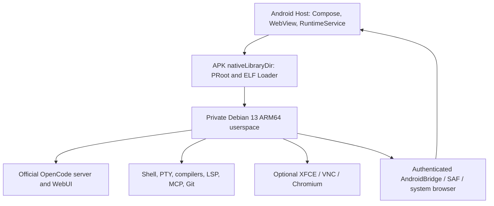

# OpenCode Android Full

English | [简体中文](README.zh-CN.md)

[](https://github.com/B5-Software/opencode-android-full/actions/workflows/android.yml)
[](LICENSE)
[](https://github.com/B5-Software/opencode-android-full/releases)

[](https://b5-software.github.io/opencode-android-full/download.html?asset=apk)
[](https://b5-software.github.io/opencode-android-full/download.html?asset=core)

[Multilingual website & one-click downloads](https://b5-software.github.io/opencode-android-full/) · The update package upgrades OpenCode's matching frontend/backend; use the APK for a new installation or Android host update.

A local development workstation for Android: the official OpenCode CLI and WebUI, Debian 13 ARM64 development tools, terminals, files, and an optional Linux desktop in one application.

面向 Android 的本地开发工作站：官方 OpenCode 前后端、Debian 13 ARM64 开发套件、终端、文件管理与可选 Linux 桌面。完整说明见 [中文 README](README.zh-CN.md)。

**Unofficial, under active development.** Current physical-device evidence primarily comes from a Redmi K30 5G running Android 16 with 4 KiB pages. The full Android 10–16, tablet, peripheral, and ARM64 16 KiB acceptance matrix remains open. See [validation](docs/VALIDATION.md) and the [project plan](docs/PROJECT_PLAN.zh-CN.md).

## Features

- Matching official OpenCode server and WebUI from a pinned upstream `dev` commit. Agent, sessions, shell, PTY, LSP, MCP, plugins, and Git retain the upstream implementation.
- Debian 13 with `curl`, `wget`, Git, GitHub CLI, SSH, Node.js, Python, Rust, Clang, and development dependencies included. Package versions and archives are locked; `apt` remains available.
- Fullscreen Android navigation through a floating control with adjustable opacity, portrait/landscape layouts, system light/dark appearance and native accent colors. Native resources cover 68 locale variants, follow system language, and support RTL.
- Multiple interactive terminals, a native file browser/editor, Android file import/export and sharing, and project previews in a separate browser process.
- Automatic local-server pairing and restoration of the last confirmed workspace/session. The first workspace is `/workspace/helloworld`.
- Optional XFCE, TigerVNC/noVNC, and Debian Chromium, installed on demand, sharing project files with OpenCode and terminals.
- Explicit runtime recovery, encrypted workstation backups, and publisher-signed OpenCode updates with confirmation, snapshots, health checks, and rollback.

The Android container handles input, navigation, lifecycle, and rendering integration. It does not replace or restyle the official OpenCode frontend. Language and theme choices inside that frontend remain upstream behavior.

## Requirements and installation

**Android 10 / API 29 minimum · Android 16 / API 36 target · ARM64.** No root, Magisk, Shizuku, or external Termux installation is required. Allow several gigabytes of free space for Debian, the development tools, and projects; desktop packages need additional space and a network connection.

Download signed engineering builds from [Releases](https://github.com/B5-Software/opencode-android-full/releases). Verify the APK against `SHA256SUMS-signed.txt` and its certificate record. Actions artifacts also contain debug, test, and unsigned APKs for development.

The first signed engineering prerelease is [v0.1.0-beta.1](https://github.com/B5-Software/opencode-android-full/releases/tag/v0.1.0-beta.1). Its 35 assets were downloaded and checked, including the APK signature, matched OpenCode update/feed signatures, and source checksums. The project signing-certificate SHA-256 is `76d8185709761f45e880fda75bf8f20674659484e4ac66e60f3cf80b9cd71b71`. This release retains the validation and audit limits above.

1. Install the ARM64 APK and open the app.
2. Prepare/start the bundled runtime from Runtime settings. The app starts and pairs with the local OpenCode service.
3. Configure your model provider in the official OpenCode interface. Inference uses your chosen cloud provider or compatible local model service.
4. Use the floating control to switch between OpenCode, Terminal, Files, Desktop, and Runtime settings.
5. Install/start the desktop when needed. Authorize GitHub in Debian with `gh auth login --web`; browser requests use Android integration.

Android requires matching signing certificates for in-place updates. Preserve an existing development installation and export projects before switching to a release signed by a different identity. Backup restoration also checks runtime publisher proofs; cross-signer migration has not been established.

## Architecture



Native launchers execute from Android's APK native-library directory. Debian ELF programs run through PRoot/Loader without lowering the target SDK. Host ELF alignment checks cover 16 KiB pages; full Debian/OpenCode operation still needs physical ARM64 16 KiB testing.

PRoot provides userspace compatibility with the Android kernel and network stack. It does not provide a VM or a separate Linux kernel sandbox. Services bind to loopback by default. Chromium sandbox compatibility requires separate assessment; the optional reduced-sandbox mode needs explicit selection and uses a separate profile.

## Build from source

Use JDK 21, Android SDK/Build Tools 36, NDK `26.1.10909125`, CMake 3.22.1, Python 3.11+, Git, and the Bun version locked in `runtime/opencode-dev.lock.json`. Linux NDK r29 builds PRoot/Loader. A Linux QEMU/binfmt chroot builder prepares the development image. Chroot privileges are required on the **build machine**, not on Android.

The complete recipe is in [.github/workflows/android.yml](.github/workflows/android.yml) and [CI documentation](docs/CI.md). Runtime assembly downloads substantial pinned upstream inputs.

```bash
# Linux, after installing the required Android tools and Bun:
export ANDROID_NDK="$ANDROID_HOME/ndk/29.0.14206865"
bash tools/ci_prepare_assets.sh
python3 tools/package_native_sources.py
bash tools/ci_prepare_notices.sh
bash gradlew assembleDebug assembleDebugAndroidTest assembleRelease testDebugUnitTest lintDebug lintRelease --no-daemon
python3 tools/check_apk.py app/build/outputs/apk/debug/app-debug.apk --sdk "$ANDROID_HOME"
```

Windows can run `gradlew.bat` after preparing the Linux runtime inputs. See [development pack](docs/DEVELOPER_PACK.md), [native execution build](native-host/build.sh), and `tools/build-opencode.ps1`.

Caches, downloaded sources, runtime packs, APKs, device data, and signing keys are excluded from Git. `runtime/` contains the input locks and inventories. Generated release metadata records the actual checkout and packaged runtime hashes. Cross-machine byte reproducibility has not yet been independently established.

## CI, updates, and source delivery

Pushes and pull requests build the ARM64 runtime and APKs and run host tests, lint, and packaging checks. Version tags additionally sign the APK and OpenCode update/feed packages and publish an engineering prerelease using repository signing secrets. CI success covers host checks and does not certify the device matrix.

Release assets include checksums, a public signing-certificate record, build metadata, project/native source archives, dependency records, Debian SPDX inventory and license texts, and exact Debian source files with descriptors and distribution patches. The source collector verifies pinned archive signatures, index hashes, exact versions, sizes, and SHA-256 checksums. See [Debian inventory and source delivery](docs/DEBIAN_INVENTORY.md).

The APK also includes Maven/npm notice archives. Release materials retain the exact Android library source JARs, a manifest-based OpenCode dependency notice superset, and original font attribution records. Declaration-only cases and review boundaries are explicit in [dependency notices](docs/DEPENDENCY_NOTICES.md).

[OpenCode updates](docs/OPENCODE_UPDATES.md) update the matching frontend/backend pair together, with publisher authentication and explicit installation. [Backups](docs/BACKUP_RESTORE.md) encrypt persistent runtime/project state and restore it transactionally.

## Documentation and contributing

| Area | Documentation |
| --- | --- |
| Device evidence and pending acceptance | [Validation](docs/VALIDATION.md) |
| Project plan | [中文项目计划](docs/PROJECT_PLAN.zh-CN.md) |
| Workspaces and recovery | [Workspace restoration](docs/WORKSPACE_RESUME.md), [Lifecycle](docs/LIFECYCLE.md) |
| Android integration | [AndroidBridge](docs/ANDROID_BRIDGE.md), [Project preview](docs/PROJECT_PREVIEW.md) |
| Appearance and languages | [i18n](docs/NATIVE_I18N.md), [IME rendering](docs/IME_VIEWPORT.md), [App icon](docs/APP_ICON.md) |
| Builds | [CI](docs/CI.md), [Debian development pack](docs/DEVELOPER_PACK.md) |
| Contributions and security | [Contributing](CONTRIBUTING.md), [Security](SECURITY.md) |

The validation record distinguishes scripted-model and local Git tests from real cloud-provider, remote GitHub, physical-device, and stress acceptance. Initial translations need native-speaker review. Reports and patches expanding these checks are welcome.

## License and attribution

New project code is **GPL-3.0-or-later**; see [LICENSE](LICENSE). Components retain their own licenses, including OpenCode's MIT license and Debian package copyright notices. Source/build materials and remaining audit boundaries are documented in [THIRD_PARTY_NOTICES.md](THIRD_PARTY_NOTICES.md).

This is an independent, unofficial port, not an endorsement by OpenCode, Debian, or other upstream projects. Launcher artwork was generated using the official OpenCode mark as a reference; provenance is recorded in [APP_ICON.md](docs/APP_ICON.md).
